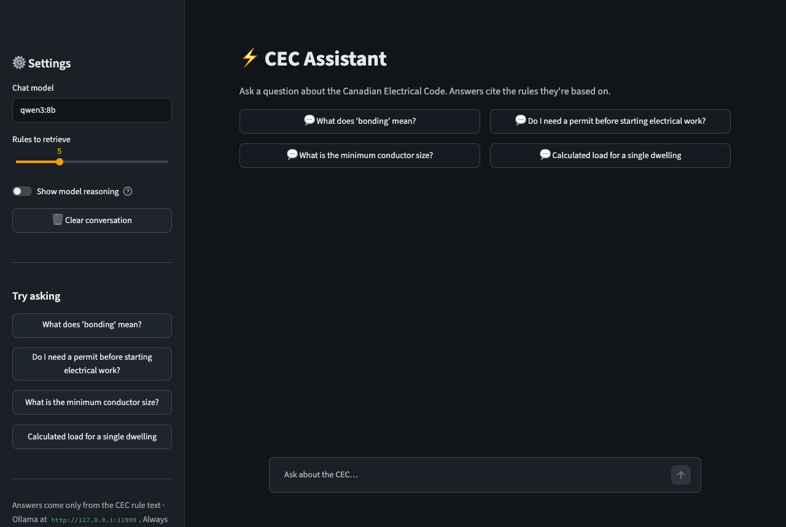

# ⚡ CEC Assistant

Ask questions about the **Canadian Electrical Code** and get answers grounded in the rule text, with the
supporting rules cited. Retrieval uses local embeddings; answers are written by a local LLM through
[Ollama](https://ollama.com), so nothing leaves your machine.



## Quick start

1. **Install Ollama** and pull the two models:

   ```bash
   ollama pull qwen3:8b
   ollama pull nomic-embed-text
   ```

2. **Install the Python dependencies** (Python 3.10+):

   ```bash
   # macOS / Linux
   python3 -m venv .venv && source .venv/bin/activate
   pip install -r requirements.txt

   # Windows (PowerShell)
   py -3.12 -m venv .venv; .venv\Scripts\Activate.ps1
   pip install -r requirements.txt
   ```

3. **Run the web app:**

   ```bash
   streamlit run cec_app.py
   ```

   It opens at http://localhost:8501. Press `Ctrl+C` in the terminal to stop it.

Check that Ollama and both models are working with `python -m scripts.check_ollama`.

### Command line

```bash
python cec_ai.py "What size grounding conductor is required?"
python cec_ai.py -k 8 -m llama3.1 "Calculated load for a single dwelling"
```

## Configuration

Settings are read from environment variables:

| Variable              | Default                  | Purpose                                 |
|-----------------------|--------------------------|-----------------------------------------|
| `OLLAMA_HOST`         | `http://localhost:11434` | Ollama server URL                       |
| `CEC_CHAT_MODEL`      | `qwen3:8b`               | Model that writes answers               |
| `CEC_EMBED_MODEL`     | `nomic-embed-text`       | Embedding model (must match the index)  |
| `CEC_TOP_K`           | `5`                      | Rules retrieved per question            |
| `CEC_TIMEOUT`         | `300`                    | Seconds to wait for Ollama              |
| `CEC_EMBEDDINGS_FILE` | `cec_embeddings.json`    | Pre-computed rule embeddings            |

The chat model and number of rules can also be changed from the app's sidebar.

## Good questions to try

- "What does 'bonding' mean?" (Section 0)
- "Do I need a permit before starting electrical work?" (Section 2)
- "What is the minimum conductor size?" (Section 4)
- "Calculated load for a single dwelling" (Section 8)

## Project layout

```
cec/                 shared library
  config.py          environment-based settings
  ollama.py          Ollama client (embeddings, streaming generation, errors)
  retrieval.py       NumPy cosine-similarity search over rule embeddings
  prompts.py         grounded-answer prompt template
cec_app.py           Streamlit chat UI
cec_ai.py            command-line assistant
parse_cec.py         pdf/cec.txt  -> cec_rules.json
build_embeddings.py  cec_rules.json -> cec_embeddings.json (incremental)
scripts/             dev tools: check_ollama, keyword_search, semantic_search
tests/               pytest suite (no Ollama required)
```

### Rebuilding the index

Only needed if the source text or parser changes. Put the CEC text export at `pdf/cec.txt`, then:

```bash
python parse_cec.py
python build_embeddings.py
```

## Development

```bash
pip install -r requirements-dev.txt
pytest
ruff check .
```

> **Disclaimer:** This tool is an aid, not a substitute for the official Code. Always verify requirements
> against the CEC and your local authority having jurisdiction.
